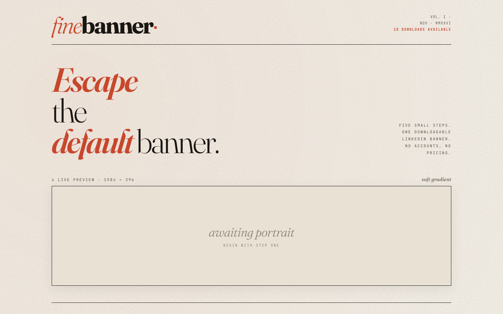

# fineBanner

**Drop in a portrait, pick a style, and get a LinkedIn banner you'd actually keep. No accounts, no pricing, nothing leaves your browser.**

[](https://github.com/mountstorm)



*Version 0, April 2026. One HTML file that makes a LinkedIn header for free and fast.*

## What it does

- **Six steps, one banner**: image, name and tagline, visual style, type, name placement, download
- **Palette from your face**: pulls a 5-color palette out of your portrait, and blends in your
  company logo's colors if you add one
- **Six visual styles**, each driven by that palette (one of them is built around a quote)
- **Safe-zone preview**: a dashed circle shows where LinkedIn will cover the banner with your
  profile picture, so your name doesn't end up behind it
- **Exact size**: exports a 1584 × 396 PNG, LinkedIn's banner dimensions
- **Fully client-side**: your photo is read in the browser and never uploaded

## Run it

It is a single static file, so there is nothing to install.

```bash
open finebanner_v0.html
```

Or serve the folder with any static server (`python3 -m http.server`) and open it.

## Known limitations

- **Downloads are capped at 10**, counted in the browser's `localStorage`. It is a soft limit:
  clearing site data resets it.
- **LinkedIn only.** The size and the profile-circle guide are hard-coded for the 1584 × 396 banner.
- **Fonts load from Google Fonts** (Fraunces and JetBrains Mono), so the first load needs a connection.
- **It is v0.** One file and no tests.

## Credits

Made by [Muzaffar Khaydarov](https://github.com/mountstorm) at Mountstorm Labs.
Type: [Fraunces](https://fonts.google.com/specimen/Fraunces) and
[JetBrains Mono](https://www.jetbrains.com/lp/mono/).
